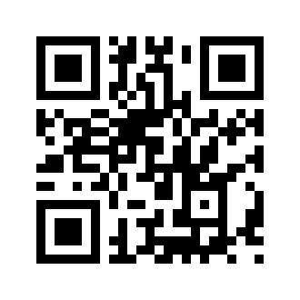
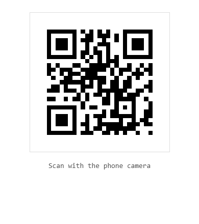

# QR code

An agent skill that turns short text or a UTF-8 file into a scannable QR code. By default the code is printed to the terminal and nothing is written to disk; `--save` writes a PNG, with an optional viewer page sized for scanning from a phone screen.
The generator is a native binary: a Windows console executable and a statically linked Linux x86_64 binary ship in the repository, so the host needs no interpreter, package manager or network access. Error correction is fixed at level M, every symbol is a regular QR code, and the viewer page never contains the encoded text.

## Samples

Click a sample to open the full-size image.

| QR code | Viewer page |
|:---:|---|
| [](docs/demo-qr.png) | [](docs/demo-page.png) |
| Text input, 25 modules, scale 10 | `--html` page, image at 70vmin |

Both samples come from `bin/qr.exe --save "https://example.com" -o docs/demo-qr.png --scale 10 --html --title "Scan with the phone camera"`. The caption is a page title and never part of the code.

## Files

| File | Purpose |
|---|---|
| `SKILL.md` | Agent entry point: contract, flags, placement and decode recipe |
| `bin/qr.exe` | Windows x86_64 console binary |
| `bin/qr-arm64.exe` | Windows ARM64 console binary |
| `bin/qr` | Linux x86_64 binary, statically linked |
| `bin/qr-arm64` | Linux ARM64 binary, statically linked |
| `rust-src/` | The crate: command line, encoder, PNG writer, terminal renderer, viewer template |
| `tools/gate.py` | 45-check acceptance gate over the shipped binary |
| `tools/argv_matrix.py` | 30-case command-line harness against the frozen fixture |
| `tools/parity.py` | Symbol parity against segno over `spec/corpus.txt` |
| `spec/` | Behaviour contract, frozen command-line fixture, parity corpus |
| `docs/` | Process manuals and the sample images |
| `CHANGELOG.md` | Version history |

## Install

The skill payload is `SKILL.md` and `bin/`. Clone the repository, then copy both into the skills folder for your agent and name the folder `qr`. The folder name must match the `name` in `SKILL.md`; `SKILL.md` names the binary for the host architecture.

```sh
git clone https://github.com/chezhenkie/qr-code-skill.git
```

| Agent | All projects | One project |
|---|---|---|
| OpenCode | `~/.config/opencode/skills` | `.opencode/skills` |
| Codex | `~/.agents/skills` | `.agents/skills` |
| Pi | `~/.pi/agent/skills` | `.pi/skills` |
| OMP | `~/.omp/agent/skills` | `.omp/skills` |

```powershell
Copy-Item -Recurse .\SKILL.md, .\bin "$HOME\.config\opencode\skills\qr"
```

```sh
mkdir -p ~/.config/opencode/skills/qr
cp -r SKILL.md bin ~/.config/opencode/skills/qr
```

`~` is your home directory; if the shell does not expand it, use the full path. The [v1.0.0 release](https://github.com/chezhenkie/qr-code-skill/releases/tag/v1.0.0) carries the same files as one archive per platform. Restart the agent if the skill does not appear.

## Use

Ask for the code. A code that only has to be looked at needs no options: the symbol is printed to the terminal. Name an output file to save it instead.

```text
Show the QR code for https://example.com in the terminal.
Save a QR code for notes/token.txt to qr/token.png with a viewer page for the phone, scale 12.
```

| Agent | Invocation |
|---|---|
| OpenCode | `@qr` |
| Codex | `$qr` |
| Pi | `/skill:qr` |
| OMP | `/skill:qr` |

Direct use, from the repository root:

```powershell
.\bin\qr.exe "https://example.com"
.\bin\qr.exe --save -f .\notes.txt -o .\qr\notes.png --scale 12 --html --title "notes"
```

```sh
./bin/qr "https://example.com"
```

The default mode prints the symbol and exits 0. In save mode the run prints the absolute path of the PNG on stdout, and with `--html` the page path after it. Arguments are checked before a file is written. A filesystem failure prints one `FAIL read:` or `FAIL write:` line and exits 1; text beyond the capacity at level M prints one `FAIL store:` line and leaves no file; a usage error prints the help text and exits 2.

## Show on screen

The terminal display is the default and needs no flag. The symbol is rendered from memory as black half blocks on a painted white background, with the quiet zone, two module rows per text row, so a dark terminal still shows the polarity a scanner expects.

```powershell
.\bin\qr.exe "https://example.com"
```

```sh
./bin/qr "https://example.com"
```

The output is UTF-8 text with a colour prefix and needs a monospaced terminal. Keep the window wider than the code: a 25-module symbol with the default quiet zone is 33 columns, and a wrapped line cannot be scanned. `--border` changes the quiet zone in both modes.

## Save a PNG

`--save` writes the PNG, and so does any option that only makes sense for a file: `-o`, `--scale`, `--html`, `--title`. The PNG goes to `qr.png` in the current directory unless `-o` names another path.

```powershell
.\bin\qr.exe --save "https://example.com" -o .\qr\out.png
.\bin\qr.exe "https://example.com" -o .\qr\out.png --html --title "scan me"
```

## Options

| Option | Meaning | Default |
|---|---|---|
| `text` | Text to encode; leave it out when using `-f` | |
| `-f, --file FILE` | Read the text from a UTF-8 file, line endings kept | |
| `--save` | Write the PNG instead of printing to the terminal | off |
| `-o, --out OUT` | PNG path; implies `--save` | `qr.png` |
| `--scale SCALE` | Pixels per module, 1 to 100; implies `--save` | 10 |
| `--border BORDER` | Quiet zone in modules, 0 to 16; both modes | 4 |
| `--html` | Write a viewer page beside the PNG; implies `--save` | off |
| `--title TITLE` | Caption on the viewer page; implies `--save` | none |
| `-h, --help` | Print the usage text | |
| `--version` | Print the version | |

Text and file input are stripped of surrounding whitespace before encoding.
In save mode the PNG is written by the tool itself as a 1-bit greyscale image, then the header is checked against the symbol size and the closing chunk is required; a mismatch removes the file and exits 1, so a printed path points at a complete image of the intended module count. The page loads that image by file name, scales it to 70vmin of the shorter viewport side, and carries a viewport tag so the size holds on a phone.

## Cleanup

The terminal mode writes nothing: its only output is stdout, so there is nothing to delete. Save mode writes only the files you name, the PNG at `-o` and, with `--html`, the page beside it, and uses no temporary folder, cache or log.

```powershell
Remove-Item .\qr\out.png, .\qr\out.html
```

```sh
rm qr/out.png qr/out.html
```

Deletion is a manual step; nothing removes the files later. A payload over capacity writes nothing, a failed write or PNG check removes the PNG, and a failed page write leaves the PNG so the run can be retried. Delete a secret as soon as the scan is confirmed, without copying it elsewhere first.

## Check

Run from the repository root:

```sh
python tools/gate.py
python tools/argv_matrix.py
```

The gate runs 45 checks over the shipped binary: decode at level M, dimensions at two scales, the page contents, the strip boundaries, error paths, a truncated PNG, and the terminal rendering, which is rebuilt from the printed blocks into a bitmap, decoded, and checked for an empty working directory. The matrix compares 30 command-line cases with the frozen fixture.
Both need Python 3; the gate also needs Pillow and zxing-cpp and exits 2 when they are missing. Both tools write their fixtures under `tools/.artifacts` and delete them on exit.

CI runs the gate and the matrix on Windows and Linux for x86_64 and ARM64, builds the crate for all four targets, checks that both Linux binaries have no dynamic dependency, and runs them on `alpine:3.21`. No local Rust toolchain is needed.

## Limits

- Level M only. Byte mode holds 2331 bytes of text, digits and uppercase fit more; longer input fails with one line.
- `--border` accepts 0 to 16 in both modes; `--scale` accepts 1 to 100 in save mode. A quiet zone of 4 or more modules scans best.
- The terminal rendering draws one column per module plus the quiet zone; a window narrower than that wraps the symbol and breaks the scan.
- Long text makes a dense symbol, so raise `--scale` for screen scanning. 2331 bytes at scale 100 is 18500 pixels per side.
- Text is stored as UTF-8. Text that a Shift-JIS encoder would place in kanji mode is written as bytes, so the symbol can need more versions.
- The viewer page loads the PNG from the same folder; copy both files together.
- Prebuilt binaries cover Windows and Linux on x86_64 and ARM64. `cargo` builds other targets from `rust-src/`.

## Secrets

A QR code that encodes a token or a password is a photographable secret. The terminal mode leaves no artefact on disk and is the default for a one-off code. In save mode, generate the files only when asked, keep them inside the project, delete them after scanning, and never send such an image to an online decoder. Scanner apps keep history, and cloud sync may upload the image.

## License

MIT
